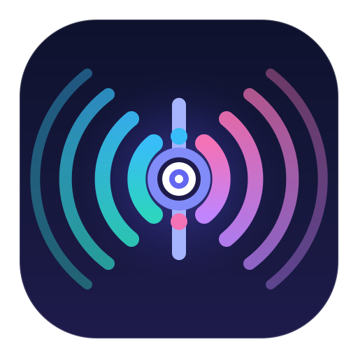
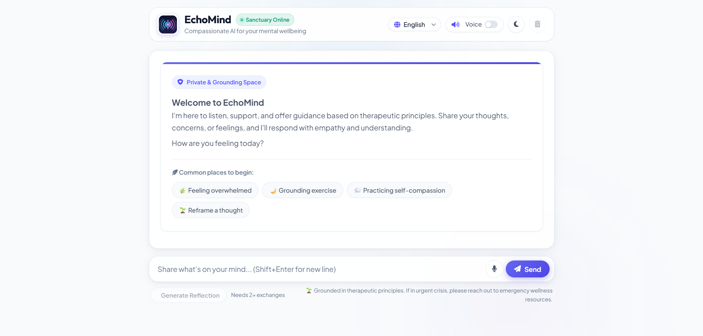
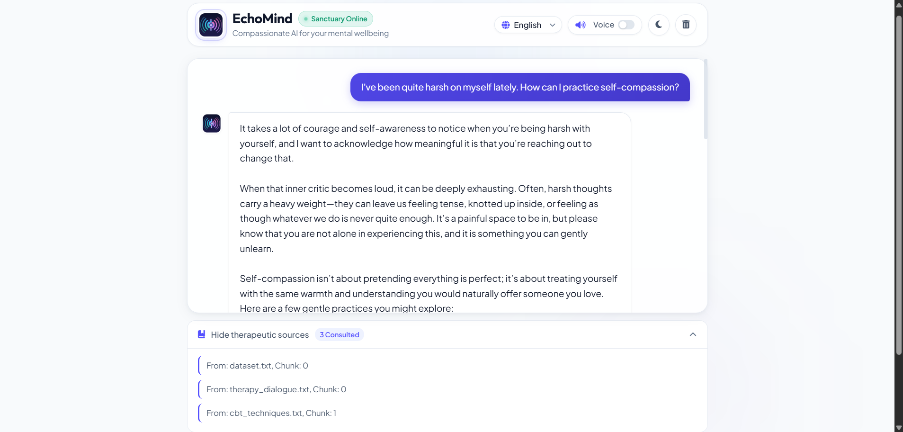
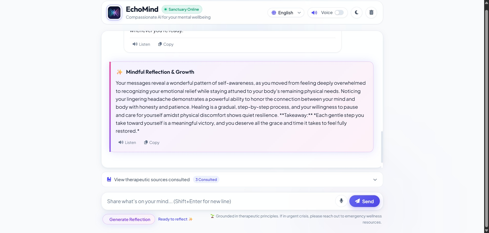

# EchoMind — Compassionate AI Therapeutic Assistant

<p align="center">
  
</p>

<p align="center">
  <em>A tranquil, empathetic AI sanctuary designed to support mental wellness, mindful grounding, and personal growth.</em>
</p>

---

## 🌟 Application Showcase

<p align="center">
  
  <em>Figure 1: Serene Sanctuary landing page with quick starter prompt chips, multilingual support, and voice settings.</em>
</p>

<br/>

<p align="center">
  
  <em>Figure 2: Empathetic therapeutic dialogue with collapsible AstraDB vector source citations.</em>
</p>

<br/>

<p align="center">
  
  <em>Figure 3: Mindful Reflection & Growth card synthesizing conversational history into positive takeaways.</em>
</p>

---

## ✨ Key Features

- **Therapeutic Dialogue:** Empathetic, compassionate AI companion guided by evidence-based cognitive and therapeutic frameworks.
- **RAG Knowledge Retrieval:** Real-time semantic vector retrieval using **DataStax AstraDB** and **SentenceTransformers** (`all-MiniLM-L6-v2`) to provide grounded insights from CBT and therapeutic dialogues.
- **Mindful Reflections:** Generates holistic, uplifting reflections highlighting resilience, recurring emotional themes, and self-compassion takeaways after conversational exchanges.
- **Modern Wellness UI:** Designed with an anti-slop, calm aesthetic featuring **Serene Light** and **Twilight Dark** modes, auto-expanding text inputs, and smooth transitions.
- **Multilingual Support:** Native experience in **English**, **Arabic (العربية)** with RTL alignment, and **French (Français)**.
- **Voice & Accessibility:** In-browser Speech-to-Text input with visual wave pulses, integrated Text-to-Speech narration, and one-click response copying.

---

## 🏗️ Architecture

```
EchoMind/
├── app_flask.py              # Main Flask web application & REST API endpoints
├── therapeutic_assistant.py  # Therapeutic persona prompt logic & Gemini generation
├── text_to_vector_db.py      # Semantic chunking, embedding generation & AstraDB queries
├── astra_connection.py       # High-performance cached AstraDB client connection
├── dataset/                  # CBT techniques, therapeutic dialogues, and guidance texts
├── static/
│   ├── css/style.css         # Modern sanctuary design system with CSS custom properties
│   ├── js/main.js            # Client-side state, voice input/output & theme controller
│   └── images/
│       ├── logo.svg          # EchoMind vector logo emblem
│       ├── logo.png          # High-resolution 512x512 brand icon
│       ├── favicon.ico       # Multi-size browser favicon
│       └── Echomind/         # Application showcase screenshots
└── templates/
    └── index.html            # Main therapeutic sanctuary web interface
```

---

## 🚀 Quick Start

### 1. Prerequisites
- Python 3.10+ (tested on Python 3.12)
- DataStax AstraDB account and database
- Google Gemini API key

### 2. Installation
```bash
# Clone the repository
git clone https://github.com/Bril3d/EchoMind.git
cd EchoMind

# Create and activate virtual environment
python -m venv venv
.\venv\Scripts\activate   # On Windows
source venv/bin/activate  # On macOS/Linux

# Install dependencies
pip install -r requirements.txt
```

### 3. Environment Configuration
Create a `.env` file in the root directory:

```env
ASTRA_DB_APPLICATION_TOKEN=your-astradb-application-token
ASTRA_DB_API_ENDPOINT=https://your-database-id-your-region.apps.astra.datastax.com
GEMINI_API_KEY=your-gemini-api-key
GEMINI_MODEL=gemini-3.5-flash
SECRET_KEY=your-flask-secret-key
```

### 4. Populate Knowledge Vector Database (Optional / First Run)
To index the clinical therapeutic texts in AstraDB:
```bash
python text_to_vector_db.py
```

### 5. Run the Application
Start the Flask web app:
```bash
python app_flask.py
```
Open **[http://localhost:5000](http://localhost:5000)** in your browser.

---

## 🌐 Multilingual Capabilities

EchoMind natively adapts its persona, UI copy, and reflections:
- **English:** Default therapeutic persona and guidance.
- **العربية:** Full Right-to-Left (RTL) layout mirroring and empathetic Arabic therapeutic framing.
- **Français:** Thoughtful, respectful French guidance and localized interaction controls.

---

## 🔒 Confidentiality & Disclaimer
*EchoMind provides mindfulness, emotional support, and therapeutic reflections based on CBT concepts. It does not replace professional clinical treatment or medical crisis intervention. If you are experiencing a crisis, please reach out to licensed emergency mental health professionals.*
